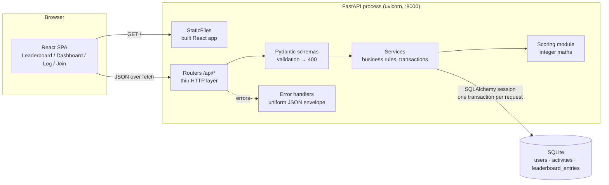
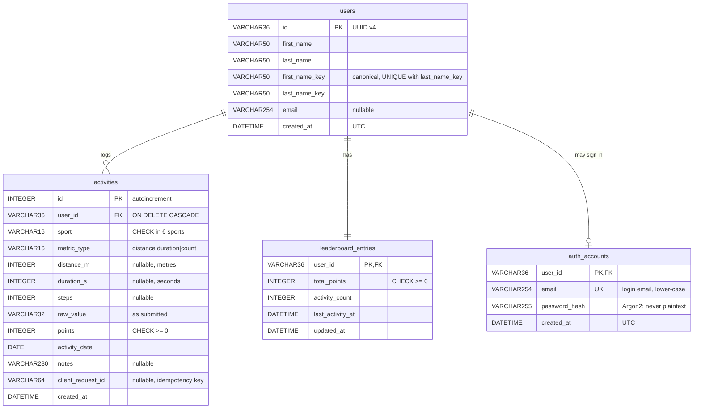

# Fitness Challenge: Software Design Document

A full-stack app that turns running, walking, cycling, swimming, gym and daily steps into one points currency, so people with different exercise habits compete on a single leaderboard.

| Layer | Choice | Why |
|---|---|---|
| Frontend | React 18 + Vite 7, Recharts, React Router 7 (HashRouter) | Component model fits the leaderboard/dashboard split; Recharts gives SVG charts with little code. Patched Vite/router versions remove the audited advisories; UI development requires Node 20.19+ or 22.12+ |
| Backend | Python 3.10+, FastAPI, Pydantic v2, PyJWT, pwdlib (Argon2) | Request validation, password hashing, JWT authentication, automatic OpenAPI docs at `/docs` |
| Persistence | SQLite via SQLAlchemy 2.0, in-memory by default | Zero setup; switch to a file with one env var |
| Tests | pytest + FastAPI TestClient; Node's built-in test runner | Backend scoring, authentication, validation, concurrency, historical ranking and UTC boundaries; frontend previews, request races, API errors, date formatting and bundle budgets |

---

## a. System architecture & data flow



**What the diagram means.** The React website (built with Vite) runs in the browser. FastAPI, served by Uvicorn on port 8000, sends the website files to the browser and receives API requests. Pydantic checks incoming data. Python service functions apply the app's rules, and `scoring.py` calculates points. SQLAlchemy connects those services to the SQLite database. Error handlers turn problems into consistent JSON responses. Email/password registration and login issue JWT bearer tokens for private account and activity routes.

**Why it is arranged this way.** Each part has one main job: FastAPI routes handle HTTP requests, Pydantic validates data, services handle app rules and database transactions, and `scoring.py` calculates points without accessing the database. Keeping these jobs separate makes the code easier to test and change. In production, `npm run build` puts the React files in `backend/app/static`, so FastAPI serves both the website and API from one server. During development, Vite runs the website on port 5173 and forwards API requests to FastAPI on port 8000.

### Authentication

- `POST /api/users` creates an account with a name, email, and password. Passwords are hashed with Argon2 using `pwdlib`; the plain password is never stored.
- `POST /api/auth/login` checks the email and password, then returns a signed JWT access token. The frontend sends it as `Authorization: Bearer <accessToken>`.
- Tokens use HS256 and expire after 60 minutes. Configure a private, stable `JWT_SECRET_KEY` for deployments. If it is omitted, the app generates a temporary key at startup, so tokens stop working after a restart.
- Registration and login, health, scoring rules, and the leaderboard are public. Dashboard reads require a valid token and allow viewing any participant's training; another participant's email and activity notes are omitted. Account reads and activity routes remain owner-only.
- User and activity records created before authentication remain intact and visible on the leaderboard. Without an `auth_accounts` row they cannot log in; the opt-in local/demo provisioning command can add credentials without recreating participants or resetting existing accounts. A new account must use a name that is not already registered.

### Access policy

| Surface | Signed out | Signed in as the owner | Signed in as another participant |
|---|---|---|---|
| Leaderboard, health, scoring rules | Allowed | Allowed | Allowed |
| Participant dashboard | 401 | Full training dashboard, email and notes | Read-only training dashboard; email and notes omitted |
| Single account details | 401 | Allowed | 403 |
| Raw activity list | 401 | Own activities only | 403 when requesting another user's activities |
| Activity submission | 401 | Allowed for token owner | 403 |

The authenticated user must still exist before dashboard reads are served. Viewing another dashboard does not change the signed-in identity. There are currently no activity edit/delete endpoints; all available activity writes are owner-only.

### Opt-in dummy credential provisioning

`python -m app.provision_dummy_accounts --output local.dummy-credentials.csv`, run from `backend` with the existing file `DATABASE_URL`, provisions only users without an authentication row. It assigns lower-case dummy emails at `example.com`, avoids case-insensitive collisions with both login and user emails, and generates an independent random password per participant. Existing working accounts are skipped.

The command changes only the legacy user's email and adds an Argon2-hashed credential row. Participant IDs, names, creation dates, activity history and leaderboard totals are preserved. All new accounts are staged in one transaction; the CSV must be written successfully before commit. Export failure rolls back the database and removes an incomplete output. Existing output files are rejected, and rerunning with a fresh path does not reset passwords.

This is a local/demo-only administrative tool, not an automatic startup migration or production account recovery flow. Back up the database first. The CSV contains plaintext passwords, must be kept private, and is excluded by `*.dummy-credentials.csv`; the database contains hashes only. A separate process cannot provision the running app's in-memory database.

### Registration flow (`POST /api/users`)

1. Pydantic validates `firstName`, `lastName` (letters, spaces, `-`, `'`, `.`; 1–50 chars), required `email`, and a password (8–128 characters). Unknown fields are rejected. Failure → **400**.
2. Service computes canonical keys: Unicode NFKC, whitespace collapsed, case-folded (`"  PRIYA "` → `"priya"`).
3. Service checks for duplicate normalized names and emails; a conflict returns **409**.
4. Insert the `users`, `auth_accounts` (email and Argon2 password hash), and `leaderboard_entries` (0 points) rows in one transaction.
5. Database uniqueness constraints protect against concurrent duplicate registration. Response **201** includes the user data and a JWT access token.

### Activity ingestion flow (`POST /api/activities`)

1. JWT dependency verifies the token and identifies the account. The requested `userId` must match the token (**401** if missing/invalid, **403** if trying to act as another user).
2. Pydantic validates the activity fields (types, enums, `extra="forbid"`), then checks the sport ↔ metricType pairing (**400 SPORT_METRIC_MISMATCH**) and value format and bounds (**400 VALIDATION_ERROR**). Valid values are converted to exact integers (metres, seconds, steps).
3. Service confirms the signed-in user exists (**404 USER_NOT_FOUND**).
4. If `clientRequestId` was already used by this user, normalized sport, metric, value, notes and any explicit activity date must match. Matching retries return the original activity with **200** and `Idempotent-Replay: true`; changed payloads return **409 IDEMPOTENCY_CONFLICT**. An omitted date retains the original date on replay, including retries after midnight. Nothing is written twice.
5. For steps, one entry per user per day (**409 DAILY_STEPS_EXISTS**).
6. Points are calculated, the activity is inserted, and `leaderboard_entries` is incremented with an atomic `UPDATE … SET total_points = total_points + :p`, all in **one transaction**. Response **201** with the normalised value and awarded points.

---

## b. Database schema & data model



**Constraints and indexes**

| Object | Purpose |
|---|---|
| `uq_users_full_name UNIQUE(first_name_key, last_name_key)` | Duplicate-user guarantee at the storage layer |
| `auth_accounts.user_id PK,FK` | Optional one-to-one login credentials; unprovisioned legacy users have no auth row |
| `uq_auth_accounts_email UNIQUE(email)` | A login email can belong to only one account |
| `ck_activity_metric_matches_sport` | Defence in depth: the DB rejects a running row with a duration, or a row with two metrics set |
| `uq_activity_client_request UNIQUE(user_id, client_request_id)` | Idempotent retries (NULLs don't collide, so the key is optional) |
| `uq_activity_daily_steps` partial UNIQUE `(user_id, activity_date) WHERE sport='steps'` | One daily-steps entry per user per day |
| `ix_activity_user_date`, `ix_activity_date` | Dashboard timeline and leaderboard trend queries |
| `ix_lb_total_points` | Ordering the leaderboard |
| `PRAGMA foreign_keys=ON` on every connection | SQLite ships with FK enforcement off |

**Why a `leaderboard_entries` table?** It is a materialised running total, updated in the same transaction as each activity. Reads become one scan of N users instead of `SUM()` over every activity ever logged. Because it is derived data, `services.rebuild_leaderboard()` can always recompute it from `activities`, which remain the source of truth.

**Duplicate user detection strategy.** Two layers: (1) a friendly pre-check that returns the existing user's id, and (2) the `UNIQUE` constraint on canonical keys, which is the actual guarantee and closes the race between check and insert. Canonicalisation means "Priya Raman", "priya raman" and "  PRIYA   RAMAN " are the same person, while "Priya Iyer" is not. The original casing is kept for display.

---

## c. API specifications

Base path `/api`. JSON in and out. Interactive OpenAPI docs: `http://localhost:8000/docs`.

Protected routes use `Authorization: Bearer <accessToken>`. Tokens come from registration or login and expire after 60 minutes by default (`JWT_ACCESS_TOKEN_MINUTES` is configurable). The leaderboard, health check, and scoring rules are public. Signed-in participants may read any training dashboard; account details and raw activity reads/writes are restricted to the token owner.

### Error envelope (every non-2xx response)

```json
{ "error": { "code": "VALIDATION_ERROR", "message": "Request body failed validation.",
             "details": [ { "field": "value", "message": "distance supports at most 3 decimal places" } ] } }
```

| Status | Codes |
|---|---|
| 400 | `VALIDATION_ERROR`, `SPORT_METRIC_MISMATCH`, `INVALID_JSON` (FastAPI's default 422 is remapped to 400 as the spec requires) |
| 401 | `UNAUTHORIZED`, `INVALID_CREDENTIALS` |
| 403 | `FORBIDDEN` (token does not own the requested user/activity) |
| 404 | `USER_NOT_FOUND`, `NOT_FOUND` |
| 409 | `DUPLICATE_USER`, `DUPLICATE_EMAIL`, `DAILY_STEPS_EXISTS`, `IDEMPOTENCY_CONFLICT` |
| 500 | `INTERNAL_ERROR` (logged server-side; no stack trace leaked) |

### `POST /api/users`: register

Request:
```json
{ "firstName": "Priya", "lastName": "Raman", "email": "priya@example.com", "password": "correct-horse-battery" }
```
| Field | Rule |
|---|---|
| `firstName`, `lastName` | required string, 1–50 chars after trimming, letters (any script) with single spaces, `-`, `'`, `.` between parts; no digits |
| `email` | required, basic format check, stored lower-case and unique for login |
| `password` | required string, 8–128 characters; stored as an Argon2 hash |
| any other field | rejected (400) |

Responses: **201** `{ "accessToken": "jwt...", "tokenType": "bearer", "user": { "userId": "uuid", "firstName", "lastName", "email", ... } }` · **400** · **409** duplicate name/email.

### `POST /api/auth/login`: log in

Request: `{ "email": "priya@example.com", "password": "correct-horse-battery" }`. A successful login returns the same token-and-user shape as registration. Invalid credentials return **401** without revealing whether the email exists.

### `GET /api/auth/me`: current account

Requires a bearer token. Returns the account associated with that token.

### `POST /api/activities`: ingest

Requires a bearer token. The `userId` in the request must match the account identified by the token.

```json
{ "userId": "3f1c…", "sport": "running",  "metricType": "distance", "value": 5.25 }
{ "userId": "3f1c…", "sport": "swimming", "metricType": "duration", "value": "45:30" }
{ "userId": "3f1c…", "sport": "steps",    "metricType": "count",    "value": 8500,
  "activityDate": "2026-10-06", "notes": "Office day", "clientRequestId": "a8f1-…" }
```

| Field | Rule |
|---|---|
| `userId` | required, UUID format (400) and must exist (404) |
| `sport` | one of `running, walking, cycling, swimming, gym, steps` |
| `metricType` | must match the sport: distance → running/walking/cycling; duration → gym/swimming; count → steps. Otherwise **400 SPORT_METRIC_MISMATCH** |
| `value` (distance) | JSON number of km, > 0, ≤ 1000, max 3 decimal places (metre precision). Strings, booleans, NaN/Infinity rejected |
| `value` (duration) | `"min:sec"` string, minutes 0–1440, seconds `00`–`59`, total > 0 and ≤ 24 h |
| `value` (count) | JSON integer, 1–200,000. Floats like `10.5` and strings rejected |
| `activityDate` | optional ISO date, default today in UTC, not in the future, not older than 365 days |
| `notes` | optional, ≤ 280 chars |
| `clientRequestId` | optional idempotency key, ≤ 64 chars; reusing it with a different payload returns 409 |

Responses: **201** (new) or **200** with `Idempotent-Replay: true` (retry):
```json
{ "activityId": 237, "userId": "3f1c…", "sport": "walking", "metricType": "distance", "value": 1.55,
  "normalized": { "distanceKm": 1.55, "distanceMetres": 1550 }, "points": 77,
  "activityDate": "2026-10-07", "notes": null, "createdAt": "2026-10-07T17:40:47Z" }
```

### Read endpoints

| Method & route | Returns |
|---|---|
| `GET /api/leaderboard?trendDays=7&limit=` (public) | Ranked entries: `rank`, `totalPoints`, `pointsInPeriod`, `previousRank`, `rankChange`, `trend` (`up/down/same/new`) |
| `GET /api/users` (bearer token) | User list without email addresses |
| `GET /api/users/{id}` (own account only) | Signed-in user's details and totals |
| `GET /api/users/{id}/dashboard?days=30` (signed-in participants; 7-180 days) | Summary (rank, streak, active days, favourite sport), `bySport`, daily `timeline`, `cumulative`, `recentActivities`; other participants' emails and notes omitted |
| `GET /api/activities?userId=&limit=50` (own activities only) | Signed-in user's activity log |
| `GET /api/scoring-rules` (public) | Conversion table (single source of truth) |
| `GET /api/health` (public) | Liveness + DB check |

---

## d. Scoring & normalisation logic

| Sport | Unit | Rate | Rule |
|---|---|---|---|
| Running | 1 km | 100 pts | `floor(km × 100)` |
| Walking | 1 km | 50 pts | `floor(km × 50)` |
| Cycling | 1 km | 25 pts | `floor(km × 25)` |
| Swimming | 1 full minute | 15 pts | `floor(seconds / 60) × 15` |
| Gym | 1 full minute | 5 pts | `floor(seconds / 60) × 5` |
| Daily steps | 100 steps | 1 pt | `floor(steps / 100)` |

**No floating point anywhere in the scoring path.** Values are converted to integers at the edge, and every formula is integer arithmetic:

```python
distance_m = int(Decimal(str(km)) * 1000)          # 1.55 km -> 1550 m, exact
points     = (distance_m * POINTS_PER_KM[sport]) // 1000   # 1550*50//1000 = 77
points     = (duration_s // 60) * POINTS_PER_MINUTE[sport] # "1:55" -> 115 s -> 1 min -> 15
points     = steps // 100                                   # 399 -> 3
```

Why this matters: in binary floating point `0.29 * 100 == 28.999999999999996`, so a naive `math.floor(km * rate)` awards 28 points for a 0.29 km run instead of 29. Converting through `Decimal(str(value))` to integer metres removes the problem; the test suite includes this case.

Limiting distance to 3 decimal places (1 m) loses nothing: every point boundary falls on a whole number of metres (every 10 m for running, 20 m walking, 40 m cycling), so flooring to metres can never change a score. Durations use `mm:ss`, so seconds are already integers.

Points are computed once at write time and stored on the activity. If rates ever change, historical activities keep the points they earned (a rescoring job would be an explicit decision, not a side effect).

---

## e. Frontend architecture & visualisations

```
src/
├── main.jsx            HashRouter + root render
├── App.jsx             top bar, routes
├── api.js              fetch wrapper, bearer-token handling, ApiError
├── sports.js           colours, labels, client-side points preview (mirrors scoring.py)
├── useCurrentUser.js   signed-in user ID, synced with localStorage
├── components/
│   └── Status.jsx      Loading, ErrorBox (renders server field errors)
└── pages/
    ├── Leaderboard.jsx  standings, period toggle, search, trend badges, 30 s auto-refresh
    ├── Dashboard.jsx    own or viewed participant's stats and charts
    ├── LogActivity.jsx  sport picker, metric-specific inputs, live points preview
    ├── Login.jsx        email/password sign-in
    └── Register.jsx     account creation with email/password
```

**Global Leaderboard.** Ranked list with large rank numerals (gold/silver/bronze for the top three), movement badge (▲/▼/–/New), points in the period and total points. The 7-day/30-day toggle re-requests `trendDays`. Data refreshes every 30 s and when the tab regains focus. The current user's row is marked; signed-in users can click any athlete's name to view their dashboard.

**Personal Dashboard.** Four headline stats (rank with movement, total points, day streak, activity count), then:

| Visual | Chart | Data |
|---|---|---|
| Activity history | Stacked bar, one colour per sport | `timeline[]` points per sport per day (14/30/90-day window) |
| Volume over time | Area chart with measure toggle | cumulative points, or daily km / minutes / steps |
| Sport preference | Donut + legend with share, sessions and raw volume | `bySport[]` |
| Recent activities | Table | last 15 activities |

Duration volume sums full recorded seconds (`durationSeconds`) and derives fractional `durationMinutes` for charts. Only scoring floors each session to completed minutes; a 1:55 gym session retains 115 seconds of volume while earning 5 points. Zero-point sessions remain visible without dividing by zero in sport shares.

Dashboard viewing is available to signed-in participants through `/dashboard/:viewedUserId`. Other participants' dashboards are read-only and omit email and activity notes. `/dashboard` remains the signed-in user's own dashboard; activity writes are always owner-only.

The dashboard compares the route's viewed ID with the signed-in ID to label training history and hide owner-only logging actions. A back-to-leaderboard link is available on both views. Protected routes redirect signed-out users to `/login`; the join form requires email and password and uses native browser validation before sending the request.

**Ranking strategy** (server-side, `services.leaderboard`):
- **Standard competition ranking** ("1-2-2-4"): tied totals share a rank and the next rank skips. Display order within a tie is alphabetical, which is stable and doesn't imply a hidden winner.
- **Trend**: historical standings use submission timestamps (`SUM(points) WHERE created_at < midnight UTC after the cutoff day`). Only users registered before that boundary participate in previous ranks. `rankChange = previousRank − currentRank` (positive = climbed); later registrants are `new`. Logging a backdated workout today changes current points but never rewrites past standings. Period points likewise count submissions since that boundary; dashboard training charts continue to use workout dates. Seeded demo data simulates historical registration and submission timestamps.
- Ranks are computed on the server so every client agrees; the frontend never re-ranks.

The points preview on the log form mirrors the server formula and metric bounds for instant feedback. Invalid inputs do not preview awardable points; the server always validates and recomputes, and its number is what gets stored and shown. Decimal strings are converted directly to integer metres rather than rounded across a point boundary.

Read requests share `useApiRead`: superseded requests are aborted and guarded so late data/errors cannot replace the current period. Cleanup cancels reads on unmount. The frontend stores the bearer token in localStorage and clears it when the API reports an expired or invalid token. Native Node tests exercise out-of-order responses, stale failures, cancellation, and bearer-token handling without another test framework.

**Calendar policy:** UTC defines today, date validation, daily-step uniqueness, streaks, chart windows and ranking cutoffs. The activity form defaults to the UTC date and labels it; date-only labels explicitly format in UTC so western timezones cannot shift a comparison date backward. Recorded workout dates remain date-only values, not browser-local timestamps.

The dashboard is route-lazy-loaded, keeping Recharts out of the initial leaderboard bundle. Suspense displays a loading state and a page error boundary offers an explicit reload if a chunk fails. The production build retains Vite's default 500 kB chunk warning rather than hiding it.

The served HTML shell revalidates with `Cache-Control: no-cache`; Vite's hashed asset names identify the current build. Rebuild the bundled frontend after UI changes, restart after backend changes, and hard-refresh or use a cache-bypassing URL if a browser still shows the pre-authentication form.

---

## f. Trade-offs & edge cases

### Trade-offs

| Decision | Benefit | Cost / mitigation |
|---|---|---|
| In-memory SQLite (default) | No setup, fast, clean slate per run | Data is lost on restart. Set `DATABASE_URL=sqlite:///./fitness.db` to persist; demo data is reseeded on an empty DB |
| Single shared connection + async gate for in-memory mode | One connection gives the whole app the same DB; the gate keeps request sessions from interleaving | All DB requests are serialised, including reads. Waiting uses no worker threads, preventing worker-pool deadlock during bursts. Cancellation-safe session cleanup finishes before the gate is released. File mode uses a normal pool with WAL + busy timeout |
| Materialised `leaderboard_entries` | O(users) leaderboard reads | Two writes per activity, kept consistent by a single transaction and atomic `UPDATE x = x + n`; rebuildable from `activities` |
| Trend computed on read from submission timestamps | Backdated workouts cannot rewrite past ranks; no snapshot jobs | O(activities) query per leaderboard load; assumes the current append-only activity model. Future edit/delete features need an immutable event log or snapshots |
| Points stored at write time | Fast reads, history stable if rules change | Rule changes need an explicit rescoring migration |
| Canonical full-name uniqueness | Prevents differently cased/spaced duplicate names | Two people with the same full name cannot both register |
| JWT bearer authentication | Protects account and activity endpoints without server-side sessions | Tokens expire after 60 minutes by default; configure a stable secret for deployments. Legacy accounts require explicit credential provisioning |
| Shared authenticated dashboards | Participants can compare training from the leaderboard | Email and notes are owner-only; shared dashboard access never grants activity-write permission |
| Token in localStorage | Keeps the user signed in across page reloads | JavaScript can access it; deploy over HTTPS and prevent cross-site scripting |
| Backend serves the built frontend | One process, one port, no CORS, easy to share | Frontend changes need `npm run build` (or use the Vite dev server) |
| HashRouter | Deep links work from static hosting with no server rewrite rules | URLs contain `#/` |

### Edge cases handled

| Case | Handling |
|---|---|
| Concurrent identical registrations | `UNIQUE` constraint + `IntegrityError` → 409. Test: 10 parallel requests → exactly one 201 and nine 409s |
| Missing/invalid authentication | Protected routes return 401; the frontend clears the stored token |
| Accessing another user's account or activities | API checks the token owner and returns 403 |
| Pre-authentication users | Records remain on the board; the opt-in local backfill adds logins without losing history or resetting working accounts |
| Viewing another participant's dashboard | Valid-token read allowed; email and notes omitted; cross-account writes still return 403 |
| Dummy credential email collision or rerun | Case-insensitive reserved-email checks and suffixes; working accounts are skipped and CSV files are never overwritten |
| Dummy credential export fails | Transaction rolls back and an incomplete CSV is removed |
| Concurrent activity posts for one user | Serialised transaction + atomic increment. Test: 80 parallel posts → total exactly 8,000 |
| Request bursts exceed available worker threads | Async admission for the shared in-memory connection leaves workers available for the active request. Regression: 64 writes plus 64 health reads complete with four worker slots and exact totals; cancelled and failed sessions release the gate and roll back uncommitted work |
| Double-click / network retry | `clientRequestId` returns the original activity (200, `Idempotent-Replay`). The UI generates one key per form submission |
| Floating-point flooring errors | Integer metres via `Decimal` (0.29 km running = 29, not 28) |
| Sub-unit activity (0.039 km cycling, 0:59 gym, 99 steps) | Accepted, scores 0 points (spec floors; the activity is still history) |
| Wrong value type | `"5"` for distance, `10.5` steps, `30` (number) for duration, `true` anywhere → 400 (strict types; booleans are not numbers) |
| `NaN` / `Infinity` | Python's JSON parser accepts them; explicitly rejected |
| Malformed duration | `"1:60"`, `"1:5"`, `":30"`, `"1:00:00"` → 400 |
| Absurd values | Bounds: ≤1000 km, ≤24 h, ≤200,000 steps → 400 |
| Future / ancient dates | Future or >365 days ago → 400 |
| Second steps entry same day | 409 `DAILY_STEPS_EXISTS` |
| Unknown or extra fields | `extra="forbid"` → 400 (catches typos like `"distnace"`) |
| Malformed JSON | 400 `INVALID_JSON` |
| Non-existent user / bad UUID | 404 / 400 respectively |
| Name variants | Case, spacing and Unicode-normalisation-insensitive duplicate check |
| Leaderboard ties | Shared rank, skip next |
| Saved user ID without a token / expired token | Startup discards an ID without a token; API 401 clears authentication and redirects protected views to login |
| `crypto.randomUUID` unavailable (HTTP over LAN is not a secure context) | Fallback id generator |
| Unknown `/api/*` route | JSON 404, never the HTML app |
| Unhandled exceptions | Logged; client gets a generic 500 envelope with no internals |

### What I'd add for production
OAuth or email magic-link authentication, account recovery and credential rotation; PostgreSQL with the same schema; Alembic migrations; rate limiting on login and POST endpoints; leaderboard snapshots and caching; pagination on activity lists; structured logging and metrics; containerised deployment. Local dummy credential provisioning is not a substitute for production onboarding or password recovery.

### Continuous integration
GitHub Actions checks Windows/Linux and Python 3.10/3.14 against memory and persistent SQLite. A Node 22 job installs from the lockfile, audits dependencies, builds, runs frontend regressions and checks that the committed static bundle matches source. Tests enforce an initial JavaScript budget of 250 kB and a 500 kB maximum per chunk. No additional test framework is required.
